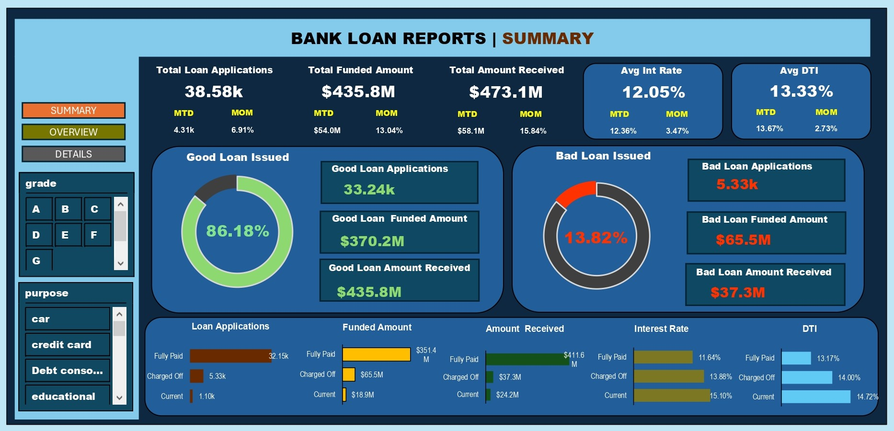
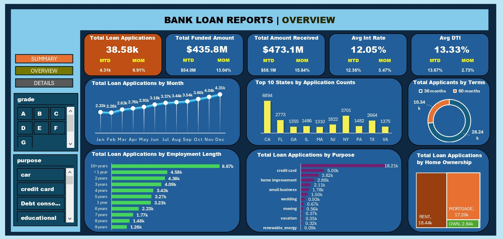

# 🏦 Bank Loan Analysis Dashboard | Excel

An end-to-end **Excel data analytics project** that turns 38,576 loan records into KPI-driven dashboards for monitoring loan performance, borrower behaviour and portfolio risk.

## 📌 Table of Contents
1. [Project Overview](#-project-overview)
2. [Business Problem](#-business-problem)
3. [Dataset](#-dataset)
4. [Workbook Structure](#-workbook-structure)
5. [Approach](#-approach)
6. [KPIs Defined](#-kpis-defined)
7. [Dashboards](#-dashboards)
8. [Key Insights](#-key-insights)
9. [Recommendations](#-recommendations)
10. [Skills Demonstrated](#-skills-demonstrated)


---

## 📖 Project Overview
A bank's lending team needs a quick, reliable view of **how many loans are being issued, how much money is going out and coming back, and how risky the portfolio is.** This project builds that view in Microsoft Excel using data cleaning, Excel Tables, PivotTables, PivotCharts, slicers and two interactive dashboards (**Summary** and **Overview**).

## 🎯 Business Problem
Stakeholders wanted answers to questions such as:
- How many loan applications were received, and how much was funded and recovered?
- How are applications, funded amount and repayments changing month over month?
- What share of the portfolio is **Good Loan** vs **Bad Loan**?
- Which states, loan purposes, terms, employment lengths and home-ownership groups drive demand?
- How do interest rate and Debt-to-Income (DTI) ratio vary across loan statuses?

## 📂 Dataset
| Item | Detail |
|---|---|
| Records | **38,576** loans (one row per loan, unique `id`) |
| Columns | 24 original fields + 1 derived field (`Good Vs Bad Loan`) |
| Period | Loans issued **1 Jan 2021 – 12 Dec 2021** |
| Geography | 50 US states + DC (`address_state`) |
| Application type | Individual |

**Key fields**

| Group | Columns |
|---|---|
| Identifiers | `id`, `member_id` |
| Borrower | `emp_title`, `emp_length`, `home_ownership`, `annual_income`, `verification_status`, `address_state` |
| Loan | `loan_amount`, `term`, `int_rate`, `installment`, `grade`, `sub_grade`, `purpose`, `dti`, `total_acc` |
| Performance | `loan_status`, `total_payment`, `issue_date`, `last_payment_date`, `next_payment_date`, `last_credit_pull_date` |

## 🗂 Workbook Structure
| Sheet | Purpose |
|---|---|
| `Financial loan data` | Cleaned and modified dataset, stored as an Excel Table, with the derived **Good Vs Bad Loan** column |
| `loan API` | PivotTable / PivotChart workspace: every KPI and chart is aggregated here |
| `Summry Dashbord` | **Summary dashboard** – headline KPIs, MTD / MoM, Good vs Bad loan analysis and loan-status grid |
| `Overview Dashbord` | **Overview dashboard** – trends and breakdowns by month, state, term, employment length, purpose and home ownership |

## 🛠 Approach
1. **Data preparation** – loaded the raw loan file, converted it to an Excel Table, checked data types (dates, currency, percentages), checked for duplicate IDs (none found) and reviewed missing values (only `emp_title` has blanks).
2. **Feature engineering**
   - `Good Vs Bad Loan`: *Fully Paid* or *Current* → **Good Loan**; *Charged Off* → **Bad Loan**.
   - Month number / name derived from `issue_date` to power MTD and MoM analysis.
3. **Aggregation** – built 15 PivotTables on the `loan API` sheet and `GETPIVOTDATA` formulas for the KPI cards.
4. **Visualisation** – built PivotCharts (bar, line, doughnut, treemap), grouped them into dashboard layouts and styled them with a consistent colour theme.
5. **Interactivity** – added **slicers** (Grade, Purpose) and navigation buttons (Summary / Overview / Details) so users can filter the whole dashboard.

## 📏 KPIs Defined
| KPI | Definition | Value |
|---|---|---|
| Total Loan Applications | `COUNT(id)` | **38,576** |
| Total Funded Amount | `SUM(loan_amount)` | **$435.76M** |
| Total Amount Received | `SUM(total_payment)` | **$473.07M** |
| Average Interest Rate | `AVERAGE(int_rate)` | **12.05%** |
| Average DTI | `AVERAGE(dti)` | **13.33%** |
| MTD (Dec 2021) Applications / Funded / Received | filtered to latest month | **4,314 / $53.98M / $58.07M** |
| MoM change (Dec vs Nov) | `(MTD − PMTD) / PMTD` | **+6.91% / +13.04% / +15.84%** |
| Good Loan % | Good loans ÷ all loans | **86.18%** |
| Bad Loan % | Bad loans ÷ all loans | **13.82%** |

## 📊 Dashboards

**Summary dashboard**



**Overview dashboard**




## 🔍 Key Insights
- **Strong growth through the year:** monthly applications rose from **2,332 in January to 4,314 in December** (+85%). December funded amount grew 13.0% over November.
- **The portfolio is healthy overall:** **86.2%** of loans are Good; **13.8%** (5,333 loans) are Charged Off.
- **Bad loans are costly:** $65.5M was funded to bad loans but only **$37.3M (≈57%)** has been received back.
- **Risk rises sharply as grade falls:** the charge-off rate climbs from **5.7% (Grade A)** to **~31% (Grades F–G)**.
- **Longer terms are riskier:** 60-month loans have a **22.3%** bad-loan rate vs **10.7%** for 36-month loans. 73% of loans are 36-month.
- **Debt consolidation dominates demand:** 18,214 applications (**47%**) and $232M funded, followed by credit card (4,998) and other (3,824).
- **Geographic concentration:** California leads with 6,894 applications, then New York (3,701), Florida (2,773) and Texas (2,664).
- **Borrower profile:** most borrowers rent (18,439) or have a mortgage (17,198); 8,870 borrowers have 10+ years of employment.
- **Charged-off loans carry a higher DTI/interest than Fully Paid loans:** average interest rate is 13.9% for Charged Off vs 11.6% for Fully Paid.

## 💡 Recommendations
1. Tighten approval criteria or price for risk on **Grades E–G** and on **60-month** terms.
2. Monitor the **Debt consolidation** segment closely – it is the largest exposure.
3. Track grade mix and charge-off rate alongside monthly volume, so rapid growth does not hide rising risk.
4. Review collections strategy for Charged Off loans to improve the ~57% recovery.

## 🧰 Skills Demonstrated
`Microsoft Excel` · `Data Cleaning` · `Excel Tables` · `PivotTables & PivotCharts` · `GETPIVOTDATA` · `Slicers` · `KPI Design (MTD / MoM)` · `Dashboard Design` · `Financial / Credit-Risk Analytics` · `Data Storytelling`

## 📁 Repository Structure
```
├── financial_loan_data_excel.xlsx   # Workbook: data, pivots, dashboards
├── README.md
├── Project_Report.docx              # Detailed project report
└── images/                          # Dashboard screenshots and charts
```
